# lesion-symptom-map-leverpull

Analysis code for *Functional vulnerability of the M1/S1 transitional zone in post-stroke motor deficits in mice* ([Osaki et al. *Neuroscience Research* 2026](https://doi.org/10.1016/j.neures.2026.105153) ).

The pipeline quantifies right-forelimb behavior in a lever-pull task after photothrombotic infarction of mouse sensorimotor cortex, registers every lesion to the Allen Mouse Brain Common Coordinate Framework (CCFv3), and maps behavioral impairment pixel by pixel on the dorsal cortical surface.

<p align="center">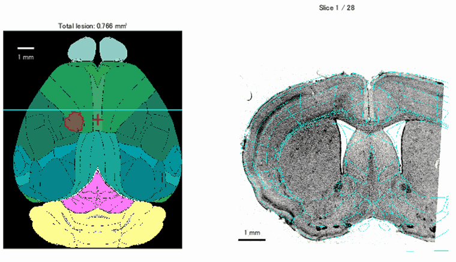&nbsp;&nbsp;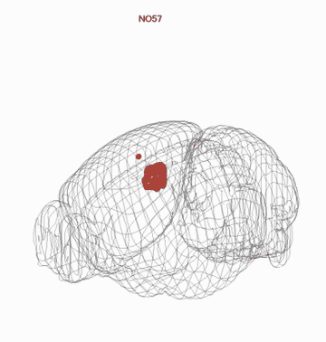</p>
<p align="center"><sub>One animal (NO57) in the single-animal viewer of <code>LeverPullTask_InfVsSham.m</code>. Left: the 28 coronal DAPI sections, each registered to its CCFv3 plane (atlas outlines in cyan, lesion outline in red), and the dorsal view on which the lesion is projected (cyan line: current section; red cross: bregma). Right: the registered lesion in 3D inside the CCFv3 brain outline ("Lesion 3D movie" button).</sub></p>

## What the code does

<table>
<tr>
<td width="50%" valign="top">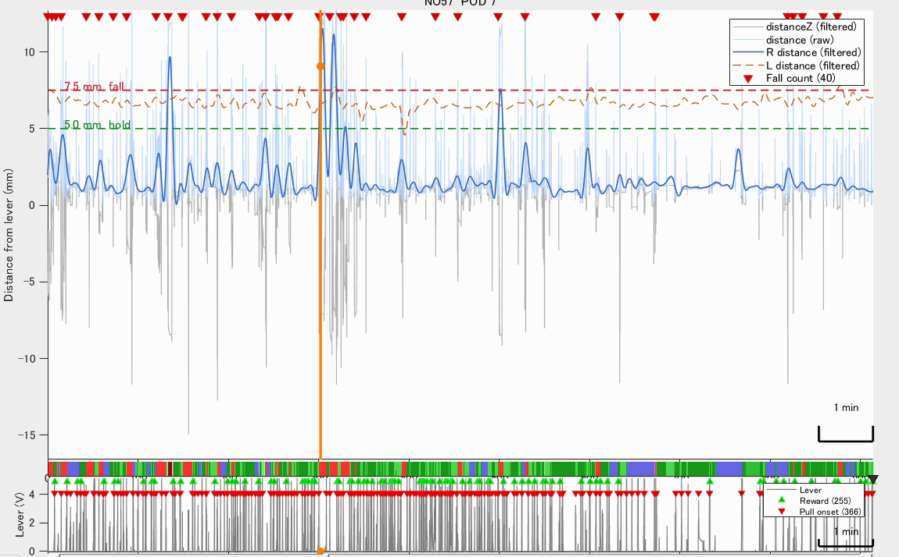<br><b>Forelimb tracking and fall detection.</b> DeepLabCut keypoints of the paw, digits and lever (frontal and mirror views) give the paw-to-lever distance; <code>GenerateFallCount.py</code> detects falls as excursions beyond the fall threshold and turns them into per-session <i>fall time</i> and <i>fall count</i>, the two measures of impairment (composite score: sum of their z-scores). Shown: one session with the hold (5 mm) and fall (7.5 mm) thresholds, detected falls (red triangles) and the lever signal with pull onsets and rewards.</td>
<td width="50%" valign="top">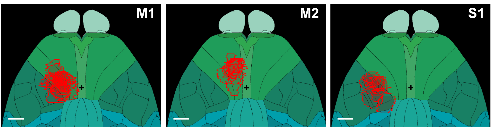<br><b>Group comparison by lesion centroid.</b> Each lesion is assigned to M1, M2 or S1 by the atlas region of its centroid; the time courses and the volume-deficit relationship are compared between the groups and with sham (Fig. 2 of the paper).</td>
</tr>
<tr>
<td valign="top">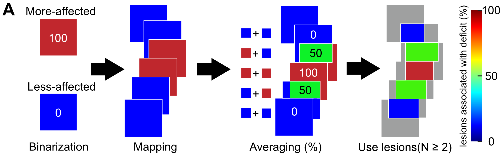<br><b>Pixel-wise lesion-symptom map.</b> Animals are split at the median of the score (more-affected = 100, less-affected = 0); every lesion is projected on the dorsal atlas and each pixel takes the mean over the lesions covering it (at least two). Clusters are tested by Fisher's exact test with cluster-mass permutation correction, separately for the acute, sub-acute and chronic phases.</td>
<td valign="top">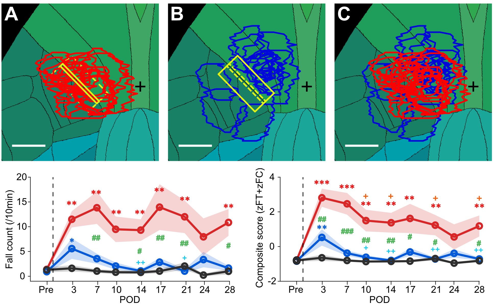<br><b>Border-crossing vs surrounding lesions.</b> Lesions are grouped by whether they cross the M1/S1 border (red) or lie beside it (blue); with lesion volume as a covariate, border-crossing lesions produce a larger and more persistent deficit over the 28-day time course (sham in black; a volume-matched version is in the supplement).</td>
</tr>
</table>

<p align="center">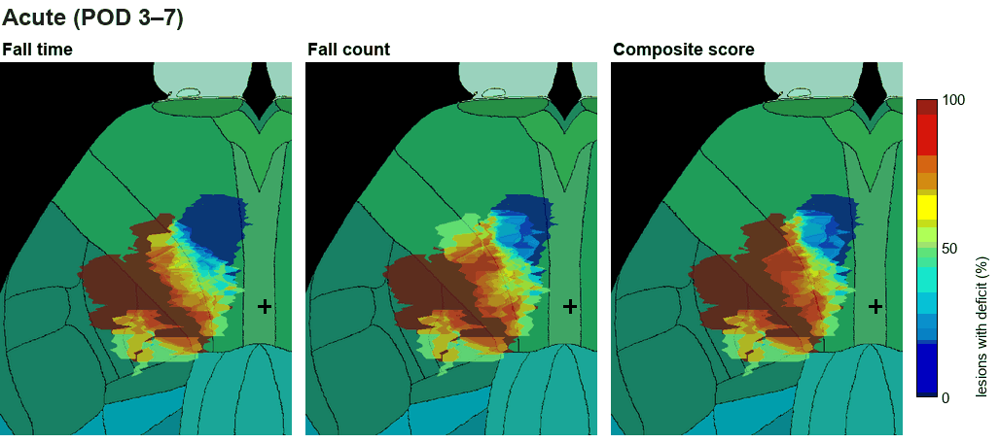</p>
<p align="center"><sub>Lesion-symptom maps over recovery. Each map fades from the acute (POD 3–7) to the sub-acute (POD 10–24) and the chronic (POD 28) phase; colour: fraction of the lesions covering a pixel that came from the more-affected half of the cohort (pixels covered by at least two lesions; black cross: bregma). The territory in which most covering lesions came from the more-affected half (red) contracts as the animals recover, while the region most associated with the deficit stays at the M1/S1 border.</sub></p>

<details>
<summary>The three maps one by one</summary>
<p align="center">
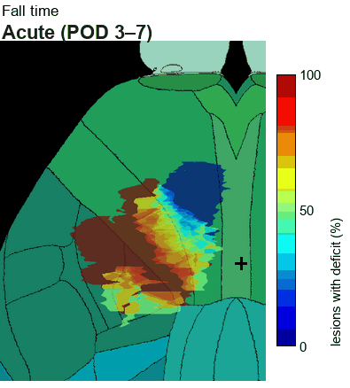&nbsp;
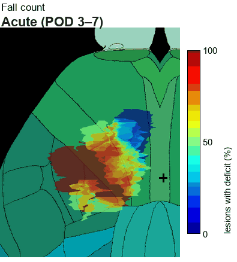&nbsp;
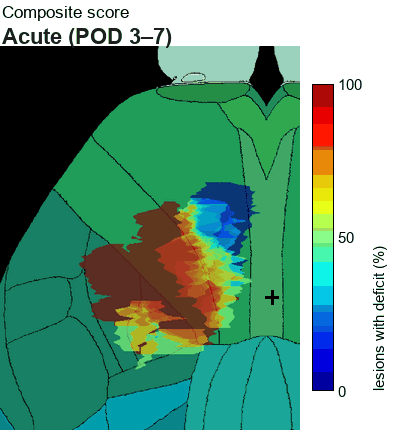
</p>
</details>

## How it works

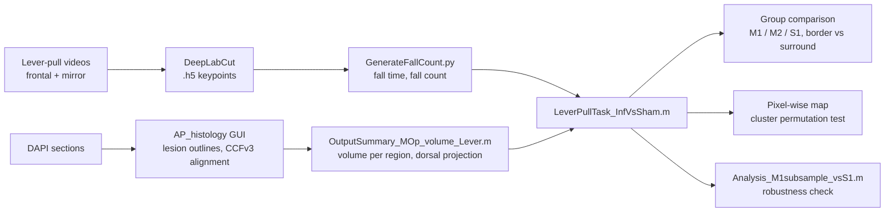

Steps 1 and 2 need the raw videos and section images; steps 3 to 5 run from the processed data deposited on Zenodo (see [Data](#data)). All figures in this README come from the pipeline outputs.

## Pipeline

| Step | Script | Input | Output |
| --- | --- | --- | --- |
| 1. Behavior: per-session forelimb metrics | `GenerateFallCount.py` | DeepLabCut `.h5` tracking of frontal + ventral (mirror) views | `<session>_FallCount.mat` (FallTime, RegularHoldTime, CrossCount per 10 min) |
| 2. Histology: lesion registration to CCFv3 | `AP_histology-master/` (`AP_histology.m` GUI, `ap_histology.annotate_lesion`) | DAPI coronal sections (`slice_1.png`, ...) | `<animal>/CCF/LesionMapAllenCCF.mat` |
| 3. Lesion volume per region and per-animal summary | `OutputSummary_MOp_volume_Lever.m`, `Output_histology_selectedAnimal.m` | outputs of 1 and 2 | `InfarctionShamIDdata.mat`, figures |
| 4. Group comparison, time courses, pixel-wise lesion–symptom map with cluster-level permutation statistics | `LeverPullTask_InfVsSham.m` (reads the animal table via `Read_NOIO_summary.m`) | outputs of 1–3 | manuscript figures |
| 5. Robustness check of the M1 vs S1 comparison (Fig. 2): exhaustive subsampling of the M1 group down to the size of the S1 group (all 92,378 subsets of 9 of the 19 M1 animals in the revised manuscript) | `Analysis_M1subsample_vsS1.m` (runs `LeverPullTask_InfVsSham.m` and reads its `BehData` / centroid data) | outputs of 4 | `Analysis_M1subsample_vsS1/` (`results.mat`, figure, `summary.md`) |

Dorsal-view region masks used for the pixel-wise map are in `AllenCCF/` (`MOp_topview_mask.mat`, `Region_topview_masks.mat`); `AP_histology-master/AllenMapTopView.m` regenerates them from the atlas.

## Requirements

* MATLAB R2023b with Statistics and Machine Learning Toolbox and Image Processing Toolbox.
* Python 3.9 with `numpy`, `scipy`, `pyyaml`, `h5py`, `matplotlib` (for `GenerateFallCount.py`). Tracking itself is done beforehand with [DeepLabCut](https://github.com/DeepLabCut/DeepLabCut).
* [npy-matlab](https://github.com/kwikteam/npy-matlab) on the MATLAB path (`readNPY`).
* Allen CCF atlas files (not included, about 9 GB): download `template_volume_10um.npy`, `annotation_volume_10um_by_index.npy` and `structure_tree_safe_2017.csv` from <https://osf.io/fv7ed/> and place them in `AllenCCF/`.

## Setup

1. Clone this repository and add it to the MATLAB path by running `startupHistology.m`.
2. Copy `local_paths.example.m` to `local_paths.m` and fill in the data locations for your machine. `local_paths.m` is ignored by git.
3. For `GenerateFallCount.py`, set the environment variable `DLC_CONFIG_PATH` to the DeepLabCut project `config.yaml`, then run:

```
python GenerateFallCount.py <animal_folder>
```

## Data

The data are deposited on Zenodo (CC BY 4.0) in two records:

* **Processed data**, <https://doi.org/10.5281/zenodo.23939516>: for 50 animals (38 single-infarction and 9 sham animals used in the paper, plus 3 dual-lesion animals excluded from the analysis), the per-session `*_FallCount.mat` with their `_corrections.mat`, the per-animal `LesionMapAllenCCF.mat` with the registered DAPI sections, `InfarctionShamIDdata.mat` and the animal summary spreadsheet. One zip per animal; this is all that steps 3 to 5 need.
* **Representative raw example (animal NO57)**, <https://doi.org/10.5281/zenodo.23971145>: the raw videos of a pre-infarction session and of post-operative day 3, the DeepLabCut tracking output of all 13 sessions, the trained DeepLabCut model and the resulting metrics, so that steps 1 and 4 can be run end to end on real data.

Full raw videos and section images of the other animals are available from the corresponding author on reasonable request.

## Related repository: lesion-ccf-registration

The histology part of this pipeline (steps 2 and 3: the AP_histology GUI with lesion annotation, the dorsal projection, the per-animal viewer with the section-by-section display and the 3D lesion movie) is also maintained as a standalone repository, [lesion-ccf-registration](https://github.com/hironobu-osaki/lesion-ccf-registration), which does not depend on the behavioral data. This repository keeps the version used for the paper. To reuse the registration step in another project, or to use only part of this pipeline, start from lesion-ccf-registration; new work on registration happens there and may be brought back here by reference rather than by copying.

## Third-party code

* `AP_histology-master/` is a modified copy of [AP_histology](https://github.com/petersaj/AP_histology) by Andrew Peters (GPL-3.0). Modifications: lesion annotation (`+ap_histology/annotate_lesion.m`), slice flipping, dorsal-view atlas maps (`AllenMapTopView.m`, `AP_histology2ccf.m`).
* `neuropixels_trajectory_explorer-main/` is a copy of [neuropixels_trajectory_explorer](https://github.com/petersaj/neuropixels_trajectory_explorer) by Andrew Peters (GPL-3.0), used for CCF coordinate handling.
* `AP_histology-master/allenCCF_repo_functions/` contains helpers from [cortex-lab/allenCCF](https://github.com/cortex-lab/allenCCF) and `natsort` by Stephen Cobeldick.
* The Allen CCFv3 atlas is (c) Allen Institute for Brain Science; see the [Allen Institute terms of use](https://alleninstitute.org/terms-of-use/).

## License

GPL-3.0. See `LICENSE`. Because the repository contains modified GPL-3.0 code, derivative works must also be distributed under GPL-3.0.

## Versions

- v1.1.0 (2026-10-20): version used for the revised manuscript. Animals with a second lesion (dual-lesion animals) are excluded when the animal list is read (`Read_NOIO_summary.m`), so that all analyses use single-lesion animals only.
- v1.0.0 (2026-09-15): version used for the original submission.
